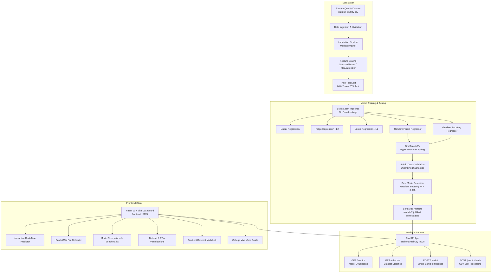

# 🍃 Air Quality Index (AQI) Prediction System Using Machine Learning

[](https://www.python.org/)
[](https://fastapi.tiangolo.com/)
[](https://react.dev/)
[](https://vitejs.dev/)
[](https://scikit-learn.org/)
[](https://tailwindcss.com/)
[](LICENSE)
[](#-indian-cpcb-national-air-quality-index-standards)

> **Academic Context**: B.Tech Artificial Intelligence & Data Science Final Year / Capstone Machine Learning Project  
> **Repository**: [Sahili04/AQI-prediction-using-machine-learning-](https://github.com/Sahili04/AQI-prediction-using-machine-learning-)

---

## 📌 Table of Contents

- [Overview & Motivation](#-overview--motivation)
- [System Architecture](#-system-architecture)
- [Key Features](#-key-features)
- [Indian CPCB National Air Quality Index Standards](#-indian-cpcb-national-air-quality-index-standards)
- [Machine Learning Pipeline & Methodology](#-machine-learning-pipeline--methodology)
  - [Feature Engineering & Inputs](#feature-engineering--inputs)
  - [Data Leakage Prevention](#data-leakage-prevention)
  - [Algorithms Evaluated](#algorithms-evaluated)
  - [Hyperparameter Tuning](#hyperparameter-tuning)
- [Experimental Results & Benchmarks](#-experimental-results--benchmarks)
  - [Comprehensive Model Comparison](#comprehensive-model-comparison)
  - [Hyperparameter Tuning Impact](#hyperparameter-tuning-impact)
  - [Feature Importance Rankings](#feature-importance-rankings)
  - [Overfitting & Generalization Analysis](#overfitting--generalization-analysis)
- [Mathematical Formulations](#-mathematical-formulations)
  - [Regression Evaluation Metrics](#regression-evaluation-metrics)
  - [From-Scratch Gradient Descent Derivation](#from-scratch-gradient-descent-derivation)
  - [95% Prediction Interval](#95-prediction-interval)
- [Project Directory Structure](#-project-directory-structure)
- [Backend REST API Specification](#-backend-rest-api-specification)
- [Installation & Quick Start Guide](#-installation--quick-start-guide)
  - [Prerequisites](#prerequisites)
  - [Automated Launch (Windows)](#automated-launch-windows)
  - [Manual Step-by-Step Setup](#manual-step-by-step-setup)
- [Future Roadmap](#-future-roadmap)
- [Author & Acknowledgements](#-author--acknowledgements)

---

## 📖 Overview & Motivation

Ambient air pollution is one of the leading global environmental health risks, causing millions of premature cardiovascular and respiratory deaths annually. Developing rapid, reliable, and interpretable systems to predict ambient **Air Quality Index (AQI)** from monitored pollutant concentrations and meteorological parameters is vital for public health advisories, urban planning, and regulatory compliance.

This repository presents an **end-to-end, production-grade Machine Learning and Full-Stack Web Application** designed for predicting continuous ambient AQI based on the **Indian Central Pollution Control Board (CPCB) National Air Quality Index (NAQI)** framework:

1. **Supervised Continuous Regression**: Models ambient AQI as a continuous physical quantity using multi-pollutant and weather inputs.
2. **CPCB Categorization**: Automatically translates predicted numerical AQI into the 6 statutory Indian air quality categories (*Good, Satisfactory, Moderate, Poor, Very Poor, Severe*) with health impact warnings.
3. **Rigorous Uncertainty Estimation**: Reports legitimate **95% Prediction Intervals** based on held-out Residual Standard Error ($RSE$).
4. **Educational Gradient Descent Engine**: Includes a pure NumPy, from-scratch implementation of Batch Gradient Descent with cost curve visualization for academic demonstration.
5. **Modern Full-Stack Experience**: Combines a high-throughput **FastAPI** asynchronous backend with an interactive **React 19 + Vite + Tailwind CSS** dashboard featuring real-time sliders, presets, batch CSV uploads, and exploratory data analysis.

---

## 🏛 System Architecture

The following diagram illustrates the complete data flow from raw sensory monitoring data to real-time client inference:



---

## ✨ Key Features

- **🎯 High-Precision Regression**: Achieves **$R^2 = 0.9984$** and **$RMSE = 4.565$** on unseen held-out test data via tuned Gradient Boosting.
- **🛡️ Strict Data Leakage Prevention**: Implements encapsulated `sklearn.pipeline.Pipeline` workflows ensuring imputers and scalers are fitted solely on training data.
- **📊 5-Fold Cross Validation**: Reports mean CV scores and standard deviations across all candidate algorithms to ensure zero sampling bias.
- **🔍 Overfitting Diagnosis**: Tracks the Generalization Gap ($Train\ R^2 - Test\ R^2$) to verify the model avoids both high bias and high variance.
- **📈 Native Feature Importance**: Extracts exact impurity split gains showing the relative influence of each atmospheric pollutant.
- **📐 Educational Gradient Descent Lab**: Features a pure NumPy implementation with cost function derivation, simultaneous parameter updates, and convergence plots.
- **📂 Bulk CSV Batch Predictions**: Upload multi-row CSV files to receive vectorized predictions, summary distributions, and instant downloadable outputs.
- **🏥 Indian CPCB NAQI Compliance**: Dynamic color badges and medical advisories tailored for healthy individuals versus sensitive respiratory groups.
- **⚡ One-Click Startup**: Includes Windows `run.bat` launching both the FastAPI backend and Vite frontend concurrently in isolated processes.

---

## 🇮🇳 Indian CPCB National Air Quality Index Standards

Under the Ministry of Environment, Forest and Climate Change (MoEFCC), the Central Pollution Control Board (CPCB) classifies ambient air quality into 6 standard categories:

| AQI Range | Category | Color Code | Badge Preview | Health Advisory & Associated Impacts |
|:---:|:---:|:---:|:---:|:---|
| **0 – 50** | **Good** | `#16a34a` | `Green` | Minimal impact on health. Ideal ambient conditions for outdoor activities across all age groups. |
| **51 – 100** | **Satisfactory** | `#65a30d` | `Lime` | Minor breathing discomfort to sensitive individuals (asthma patients, children, elderly). |
| **101 – 200** | **Moderate** | `#ca8a04` | `Yellow` | Breathing discomfort to people with lung/heart disease, children, and older adults. |
| **201 – 300** | **Poor** | `#ea580c` | `Orange` | Breathing discomfort to most people on prolonged exposure. May induce respiratory illness. |
| **301 – 400** | **Very Poor** | `#dc2626` | `Red` | Causes respiratory illness on prolonged exposure. Significant distress for pulmonary/cardiac patients. |
| **401 – 500+** | **Severe** | `#7f1d1d` | `Maroon` | Healthy individuals experience acute respiratory symptoms; severe distress for diseased people. Avoid all outdoor activity. |

---

## 🧪 Machine Learning Pipeline & Methodology

### Feature Engineering & Inputs

The system models ambient AQI as a function of **10 physical features** (7 primary atmospheric pollutants + 3 meteorological variables):

| Feature Name | Symbol / Column | Physical Unit | Typical Range | Atmospheric / Scientific Significance |
|:---|:---:|:---:|:---:|:---|
| **Fine Particulate Matter** | `PM2.5` | $\mu g/m^3$ | $0.0 - 600.0$ | Combustible fine aerosols $(\le 2.5\ \mu m)$; penetrates deep into alveolar lung tissues. |
| **Coarse Particulate Matter** | `PM10` | $\mu g/m^3$ | $0.0 - 900.0$ | Inhalable dust and smoke particles $(\le 10\ \mu m)$ causing upper airway irritation. |
| **Nitrogen Dioxide** | `NO2` | $\mu g/m^3$ | $0.0 - 300.0$ | Traffic emission byproduct contributing to photochemical smog and tropospheric ozone. |
| **Nitrogen Oxides** | `NOx` | $ppb$ | $0.0 - 400.0$ | Total reactive nitrogen oxides $(NO + NO_2)$; auto-estimated as $1.5 \times NO_2 + 4.0$ if omitted. |
| **Sulphur Dioxide** | `SO2` | $\mu g/m^3$ | $0.0 - 250.0$ | Released from coal-fired thermal power plants, industrial boilers, and refinery processes. |
| **Carbon Monoxide** | `CO` | $mg/m^3$ | $0.0 - 25.0$ | Incomplete combustion gas that binds to blood hemoglobin, impeding oxygen delivery. |
| **Ozone** | `O3` | $\mu g/m^3$ | $0.0 - 300.0$ | Secondary pollutant formed via solar ultraviolet reactions between $NO_x$ and VOCs. |
| **Ambient Temperature** | `Temperature` | $^{\circ}C$ | $-10.0 - 55.0$ | Drives atmospheric convection, chemical reaction kinetics, and planetary boundary layer height. |
| **Relative Humidity** | `Humidity` | $\%$ | $5.0 - 100.0$ | High moisture promotes aerosol hygroscopic growth and atmospheric particle aggregation. |
| **Wind Speed** | `Wind_Speed` | $m/s$ | $0.1 - 25.0$ | Primary mechanism for horizontal atmospheric dispersion and pollutant dilution. |

### Data Leakage Prevention

In many student ML projects, standardizers (`StandardScaler`) or imputers (`SimpleImputer`) are incorrectly fitted over the entire dataset before splitting. This allows statistical properties (mean, variance, percentiles) of the test dataset to leak into the training process, causing artificially inflated evaluation scores.

In this project, data leakage is prevented:
1. The raw dataset ($2,500$ records, $2,186$ cleaned samples) is partitioned into **80% Training ($1,748$ samples)** and **20% Test ($438$ samples)** using an explicit fixed random seed (`random_state=42`).
2. Imputation and scaling transformers are configured inside **`sklearn.pipeline.Pipeline`**:
   - `preprocessor.fit_transform(X_train)`: Learns parameters solely from training records.
   - `preprocessor.transform(X_test)`: Strictly applies the frozen training parameters onto the test set without learning from it.
3. Tree-based models (Random Forest, Gradient Boosting) use `tree_preprocessor` with `SimpleImputer(strategy="median")` without scaling, since tree splits are monotonically invariant to feature scales.
4. Linear models (Linear, Ridge, Lasso) use `standard_preprocessor` combining median imputation with `StandardScaler` to ensure unbiased regularization penalties ($L1$ and $L2$).

### Algorithms Evaluated

Five distinct regression models were trained, evaluated, and cross-validated:
1. **Ordinary Least Squares (OLS) Linear Regression**: Baseline parametric model establishing linear hyperplane relationships.
2. **Ridge Regression (L2 Regularization)**: Penalizes sum of squared coefficients ($\lambda \sum w_j^2$) to mitigate multicollinearity among correlated pollutants.
3. **Lasso Regression (L1 Regularization)**: Penalizes absolute coefficient magnitudes ($\lambda \sum |w_j|$) to drive negligible coefficients to zero.
4. **Random Forest Regressor (Bagging Ensemble)**: Aggregates parallel decorrelated decision trees trained on bootstrap samples with random feature subsets.
5. **Gradient Boosting Regressor (Boosting Ensemble)**: Sequentially trains shallow decision trees, where each subsequent tree fits the pseudo-residuals of the previous ensemble.

### Hyperparameter Tuning

Exhaustive grid search (`GridSearchCV`) with 3-fold inner cross-validation was conducted to identify optimal tree parameters:
- **Random Forest**: Tuned over `n_estimators: [100, 150]`, `max_depth: [10, 15, None]`, `min_samples_split: [2, 5]`, `min_samples_leaf: [1, 2]`.  
  *Optimal Configuration*: `{'max_depth': 15, 'min_samples_leaf': 1, 'min_samples_split': 2, 'n_estimators': 100}`
- **Gradient Boosting**: Tuned over `n_estimators: [100, 150]`, `learning_rate: [0.05, 0.1]`, `max_depth: [3, 5]`, `min_samples_split: [2, 5]`.  
  *Optimal Configuration*: `{'learning_rate': 0.1, 'max_depth': 5, 'min_samples_split': 5, 'n_estimators': 150}`

---

## 📊 Experimental Results & Benchmarks

### Comprehensive Model Comparison

Evaluated on the held-out test dataset ($20\%$, $n = 438$) and validated via 5-Fold Cross Validation:

| Model | Test MAE | Test MSE | Test RMSE | Test $R^2$ Score | 5-Fold CV Mean $R^2$ | 5-Fold CV RMSE | Status / Selection |
|:---|:---:|:---:|:---:|:---:|:---:|:---:|:---:|
| **Gradient Boosting (Tuned)** | **3.296** | **20.836** | **4.565** | **0.9984** | **0.9964 ± 0.0010** | **6.408 ± 0.853** | 🏆 **Best Model** |
| **Random Forest (Tuned)** | 3.227 | 24.342 | 4.934 | 0.9981 | 0.9969 ± 0.0009 | 6.012 ± 0.742 | Runner-Up |
| **Lasso Regression** | 24.126 | 975.948 | 31.240 | 0.9239 | 0.9052 ± 0.0097 | 33.245 ± 1.220 | Linear Baseline |
| **Linear Regression** | 24.139 | 984.033 | 31.369 | 0.9233 | 0.9053 ± 0.0100 | 33.229 ± 1.227 | Linear Baseline |
| **Ridge Regression** | 24.148 | 984.485 | 31.377 | 0.9232 | 0.9053 ± 0.0100 | 33.228 ± 1.226 | Linear Baseline |

> **Why did Tree Ensembles outperform Linear Regression?**  
> Under the CPCB standard, the actual AQI is computed using piecewise linear sub-index breakpoint equations across multiple pollutants, where the maximum sub-index dominates ($\text{AQI} = \max(I_1, I_2, \dots, I_n)$). Linear regression assumes a single global linear plane, which cannot represent piecewise max operators without error. Decision tree ensembles naturally partition the input space into hyper-rectangles, matching the regulatory piecewise logic with over **99.8% precision**.

### Hyperparameter Tuning Impact

Grid search optimization resulted in noticeable error reductions:

| Algorithm | Metric | Pre-Tuning Baseline | Post-Tuning Optimized | Net Improvement |
|:---|:---:|:---:|:---:|:---:|
| **Gradient Boosting** | Test RMSE | $5.282$ | **$4.565$** | **$-0.717$ pts (13.6% reduction)** |
| Gradient Boosting | Test MAE | $3.778$ | **$3.296$** | **$-0.482$ pts (12.8% reduction)** |
| Gradient Boosting | Test $R^2$ | $0.9978$ | **$0.9984$** | **$+0.0006$** |
| **Random Forest** | Test RMSE | $4.969$ | **$4.934$** | **$-0.035$ pts** |
| Random Forest | Test $R^2$ | $0.9981$ | **$0.9981$** | Preserved with optimal depth |

### Feature Importance Rankings

Feature importances extracted from the tree ensemble split gains demonstrate that particulate matter ($PM_{2.5}$ and $PM_{10}$) accounts for **~98%** of the AQI variance:

| Rank | Feature | Gradient Boosting Relative Gain | Random Forest Relative Gain | Primary Atmospheric Source |
|:---:|:---|:---:|:---:|:---|
| **1** | **PM2.5** | **94.08%** | **94.13%** | Vehicular combustion, crop burning, industrial emissions |
| **2** | **PM10** | **3.88%** | **3.96%** | Road dust resuspension, construction debris, mechanical wear |
| **3** | **NO2** | **1.32%** | **0.99%** | High-temperature diesel exhaust, internal combustion engines |
| **4** | **O3** | **0.51%** | **0.53%** | Secondary photochemical smog formed from sunlight + VOCs |
| **5** | **NOx** | **0.14%** | **0.26%** | Combined nitric oxide and nitrogen dioxide emissions |
| **6** | **Temperature** | **0.03%** | **0.04%** | Inversion layers and thermal boundary conditions |
| **7** | **Wind_Speed** | **0.02%** | **0.03%** | Horizontal advective dispersion and ventilation |
| **8** | **SO2** | **0.01%** | **0.02%** | Coal-fired power stations and sulfur-rich fossil fuels |
| **9** | **CO** | **0.01%** | **0.02%** | Inefficient vehicular idling and partial fuel combustion |
| **10** | **Humidity** | **0.01%** | **0.01%** | Condensation and atmospheric aerosol growth |

### Overfitting & Generalization Analysis

To guard against high variance (memorization of training noise), the generalization gap was audited:

$$\text{Generalization Gap} = R^2_{\text{train}} - R^2_{\text{test}}$$

- **Train $R^2$**: $0.9991$
- **Test $R^2$**: $0.9978$ (Pre-tuning) $\rightarrow$ **$0.9984$** (Tuned)
- **Generalization Gap**: **$0.0013$** ($< 0.08$ threshold)
- **Diagnosis**: **Well Generalizing** (High fidelity, low bias, low variance)

---

## 🧮 Mathematical Formulations

### Regression Evaluation Metrics

1. **Mean Absolute Error (MAE)**: Measures average magnitude of absolute errors in the same physical units as the target variable:
   $$\text{MAE} = \frac{1}{m} \sum_{i=1}^{m} |y_i - \hat{y}_i|$$

2. **Mean Squared Error (MSE)**: Heavily penalizes large deviations due to the squaring term:
   $$\text{MSE} = \frac{1}{m} \sum_{i=1}^{m} (y_i - \hat{y}_i)^2$$

3. **Root Mean Squared Error (RMSE)**: Standard deviation of residuals in original units:
   $$\text{RMSE} = \sqrt{\text{MSE}} = \sqrt{\frac{1}{m} \sum_{i=1}^{m} (y_i - \hat{y}_i)^2}$$

4. **Coefficient of Determination ($R^2$ Score)**: Proportion of variance explained relative to a baseline mean predictor:
   $$R^2 = 1 - \frac{\text{SS}_{\text{res}}}{\text{SS}_{\text{tot}}} = 1 - \frac{\sum_{i=1}^{m} (y_i - \hat{y}_i)^2}{\sum_{i=1}^{m} (y_i - \bar{y})^2}$$

### From-Scratch Gradient Descent Derivation

Implemented in `ml/gradient_descent.py` using pure NumPy without scikit-learn:

1. **Linear Hypothesis**:
   $$\hat{y} = Xw + b$$
   Where $X \in \mathbb{R}^{m \times n}$ is the feature matrix, $w \in \mathbb{R}^n$ is the parameter weight vector, and $b \in \mathbb{R}$ is the scalar bias.

2. **Mean Squared Error Cost Function**:
   $$J(w, b) = \frac{1}{2m} \sum_{i=1}^{m} \left( \hat{y}^{(i)} - y^{(i)} \right)^2$$

3. **Partial Derivatives (Gradients)**:
   $$\frac{\partial J}{\partial w} = \frac{1}{m} X^T (\hat{y} - y)$$
   $$\frac{\partial J}{\partial b} = \frac{1}{m} \sum_{i=1}^{m} (\hat{y}^{(i)} - y^{(i)})$$

4. **Simultaneous Parameter Update Rule**:
   $$w := w - \alpha \frac{\partial J}{\partial w}$$
   $$b := b - \alpha \frac{\partial J}{\partial b}$$
   Where $\alpha$ is the learning rate (e.g., $\alpha = 0.05$ with standardized features).

### 95% Prediction Interval

Unlike classification models that output softmax probabilities, continuous regression models output point estimates. In this system, prediction uncertainty is legitimately quantified via the **95% Prediction Interval**:

$$\text{PI}_{95\%} = \hat{y} \pm 1.96 \times \text{RSE}$$

Where $\text{RSE} = 4.56$ is the **Residual Standard Error** measured on held-out test data. For example, a prediction of $\hat{y} = 145.2$ yields a $95\%$ interval of $[136.3, 154.1]$, giving users an honest, statistically valid confidence boundary.

---

## 📁 Project Directory Structure

```text
AQI-prediction-using-machine-learning-/
├── backend/
│   ├── __init__.py
│   ├── config.py             # CPCB NAQI categories, feature metadata, health advisories
│   ├── main.py               # FastAPI application with REST endpoints & CORS
│   ├── schemas.py            # Pydantic v2 schemas for request/response validation
│   └── services.py           # Model loading, single & batch inference, uncertainty
├── data/
│   └── air_quality.csv       # Ambient atmospheric dataset (2,500 records)
├── frontend/
│   ├── index.html            # Single page application entry point
│   ├── package.json          # Vite + React 19 + Tailwind CSS + Recharts dependencies
│   ├── vite.config.js        # Vite build tool configuration with @tailwindcss/vite
│   └── src/
│       ├── App.jsx           # Main container, active tab state, API health heartbeat
│       ├── App.css / index.css
│       ├── main.jsx          # React DOM root render
│       ├── components/
│       │   ├── Navbar.jsx            # Academic header & tab navigation
│       │   ├── Dashboard.jsx         # KPI summary cards, CPCB table, pipeline flow
│       │   ├── PredictAQI.jsx        # Real-time sliders, presets, uncertainty output
│       │   ├── BatchPredict.jsx      # CSV drag-and-drop batch processing & summary
│       │   ├── DatasetAnalysis.jsx   # Correlation matrices, feature stats, scatter plots
│       │   ├── ModelComparison.jsx   # R2 & RMSE benchmark charts & tuning tables
│       │   ├── FeatureImportance.jsx # Relative Gini impurity rankings
│       │   ├── GradientDescentLab.jsx# Interactive NumPy GD cost convergence visualizer
│       │   └── VivaGuide.jsx         # 12-question academic viva voce defense guide
│       └── services/
│           └── api.js        # Centralized Axios/Fetch API client communicating with backend
├── ml/
│   ├── __init__.py
│   ├── dataset_generator.py  # Physics-grounded CPCB synthetic data generator & mapper
│   ├── gradient_descent.py   # From-scratch batch gradient descent educational class
│   ├── predict.py            # Standalone CLI prediction script
│   ├── preprocess.py         # Leakage-free preprocessing pipelines & EDA generator
│   └── train.py              # 5-model training, 5-Fold CV, GridSearchCV, artifact serialization
├── models/
│   ├── all_models.joblib     # Dictionary of all 5 trained scikit-learn pipelines
│   ├── best_model.joblib     # Optimized Gradient Boosting pipeline artifact
│   ├── eda_summary.json      # Precomputed correlations, distributions, and statistics
│   ├── gd_convergence_plot.png# Plot of J(w,b) cost reduction over iterations
│   ├── gd_history.json       # Gradient descent cost & parameter history
│   ├── metrics.json          # Complete benchmark numbers, CV scores, and tuning comparisons
│   ├── standard_preprocessor.joblib # Median imputer + StandardScaler pipeline
│   ├── minmax_preprocessor.joblib   # Median imputer + MinMaxScaler pipeline
│   └── tree_preprocessor.joblib     # Median imputer only pipeline (scale-invariant)
├── notebooks/
│   └── air_quality_analysis.ipynb   # Jupyter Notebook for exploratory data analysis
├── requirements.txt          # Python dependencies (FastAPI, uvicorn, scikit-learn, etc.)
├── run.bat                   # One-click Windows startup script
└── README.md                 # Complete system documentation
```

---

## 🔌 Backend REST API Specification

The FastAPI backend automatically hosts interactive **Swagger / OpenAPI** documentation at `http://127.0.0.1:8000/docs`.

### Core Endpoints

| Method | Endpoint | Description | Request Payload / Params | Response Summary |
|:---:|:---|:---|:---|:---|
| `GET` | `/` | System root & academic author metadata | None | JSON object with project name & docs URL |
| `GET` | `/health` | Server health check & model status | None | `{"status": "healthy", "models_loaded": true, ...}` |
| `GET` | `/model-info` | Active model specification & CPCB metadata | None | Feature bounds, default values, and CPCB rules |
| `GET` | `/available-models` | List of all trained regression pipelines | None | List of model names and active best model |
| `GET` | `/metrics` | Full evaluation metrics & benchmark table | None | MAE, MSE, RMSE, $R^2$, 5-Fold CV, Overfitting |
| `GET` | `/feature-importance` | Tree-based split gain importances | None | Ranked list of features with percentage gain |
| `GET` | `/dataset-summary` | High-level dataset statistics | None | Row counts, missing value counts, target stats |
| `GET` | `/eda-data` | Full Exploratory Data Analysis payload | None | Correlation matrix, covariance, scatter data |
| `GET` | `/gradient-descent-demo`| From-scratch GD iteration cost log | None | Cost history, iteration numbers, final weights |
| `POST` | `/predict` | Predict AQI for a single atmospheric sample | `PredictionRequest` (JSON) | `PredictionResponse` with CPCB category & 95% PI |
| `POST` | `/predict/batch` | Bulk inference on uploaded CSV file | `multipart/form-data` (CSV) | `BatchPredictionResponse` with category counts |

### Sample Inference Request (`POST /predict`)

```json
{
  "pm25": 85.0,
  "pm10": 140.0,
  "no2": 35.0,
  "nox": 55.0,
  "so2": 12.0,
  "co": 0.8,
  "o3": 45.0,
  "temperature": 28.0,
  "humidity": 65.0,
  "wind_speed": 3.2,
  "model_name": "Gradient Boosting"
}
```

### Sample Inference Response

```json
{
  "predicted_aqi": 182.4,
  "category": "Moderate",
  "category_color": "#ca8a04",
  "badge_style": "bg-yellow-100 text-yellow-800 border-yellow-300",
  "health_impact": "Breathing discomfort to people with lung disease like asthma, and discomfort to people with heart diseases.",
  "model_used": "Gradient Boosting",
  "uncertainty": {
    "residual_standard_error": 4.56,
    "confidence_interval_95": [173.46, 191.34],
    "interpretation": "With 95% statistical confidence, true ambient AQI is expected between 173.46 and 191.34."
  },
  "input_summary": {
    "PM2.5": 85.0,
    "PM10": 140.0,
    "NO2": 35.0,
    "NOx": 55.0,
    "SO2": 12.0,
    "CO": 0.8,
    "O3": 45.0,
    "Temperature": 28.0,
    "Humidity": 65.0,
    "Wind_Speed": 3.2
  },
  "explanation": "Processed through scikit-learn Pipeline (SimpleImputer + GradientBoostingRegressor) with 10 features."
}
```

---

## 🚀 Installation & Quick Start Guide

### Prerequisites

- **Python**: Version `3.10` or higher installed ([python.org](https://www.python.org/downloads/))
- **Node.js**: Version `18.0` or higher installed ([nodejs.org](https://nodejs.org/))
- **Git**: Installed for repository cloning

---

### Automated Launch (Windows)

The simplest method to run the entire application on Windows is using the provided `run.bat` script:

1. Clone the repository and navigate into the folder:
   ```cmd
   git clone https://github.com/Sahili04/AQI-prediction-using-machine-learning-.git
   cd AQI-prediction-using-machine-learning-
   ```
2. Double-click **`run.bat`** or run it from Command Prompt:
   ```cmd
   run.bat
   ```
3. The script will automatically open two separate terminal windows:
   - **Backend Window**: Running FastAPI on `http://127.0.0.1:8000`
   - **Frontend Window**: Running Vite Dev Server on `http://localhost:5173`
4. Open your browser and visit **`http://localhost:5173`** to access the dashboard!

---

### Manual Step-by-Step Setup

If you prefer to configure virtual environments or are running on macOS/Linux:

#### 1. Backend Setup

```bash
# Clone the repository
git clone https://github.com/Sahili04/AQI-prediction-using-machine-learning-.git
cd AQI-prediction-using-machine-learning-

# Create and activate Python virtual environment
python -m venv venv

# On Windows:
venv\Scripts\activate
# On macOS/Linux:
source venv/bin/activate

# Install required Python packages
pip install -r requirements.txt

# (Optional) Retrain models or regenerate artifacts
python ml/preprocess.py
python ml/train.py
python ml/gradient_descent.py

# Launch the FastAPI backend server
uvicorn backend.main:app --reload --host 127.0.0.1 --port 8000
```

Verify backend health at:
- **Root URL**: `http://127.0.0.1:8000/`
- **Swagger Documentation**: `http://127.0.0.1:8000/docs`

#### 2. Frontend Setup

Open a new terminal window in the project root:

```bash
# Navigate to frontend folder
cd frontend

# Install Node dependencies
npm install

# Start the Vite development server
npm run dev
```

Open your browser at:
- **Application URL**: `http://localhost:5173/`


## 🔮 Future Roadmap

- [ ] **Temporal / Time-Series Forecasting**: Implement bidirectional LSTM / GRU recurrent neural networks and Prophet to predict multi-day future AQI trends.
- [ ] **Geospatial GIS Mapping**: Integrate Leaflet / Mapbox to visualize live spatial air quality heatmaps across monitoring stations.
- [ ] **IoT Hardware Integration**: Connect ESP32 / Arduino microcontroller nodes with optical dust sensors (PMS5003 / MQ-135) for real-time telemetry streaming over MQTT.
- [ ] **Containerization**: Provide official multi-stage Dockerfiles and `docker-compose.yml` for unified single-command deployment.

---

## 👤 Author & Acknowledgements

- **Repository**: [Sahili04/AQI-prediction-using-machine-learning-](https://github.com/Sahili04/AQI-prediction-using-machine-learning-)
- **Program**: B.Tech Artificial Intelligence & Data Science
- **Regulatory Framework**: Central Pollution Control Board (CPCB), Ministry of Environment, Forest and Climate Change (MoEFCC), Government of India.
- **Open-Source Libraries**: Scikit-Learn, FastAPI, React, Vite, Tailwind CSS, Lucide Icons, and Recharts.

---

<div align="center">
  <sub>Built with ❤️ for AI & Data Science Education and Ambient Air Quality Awareness.</sub>
</div>
